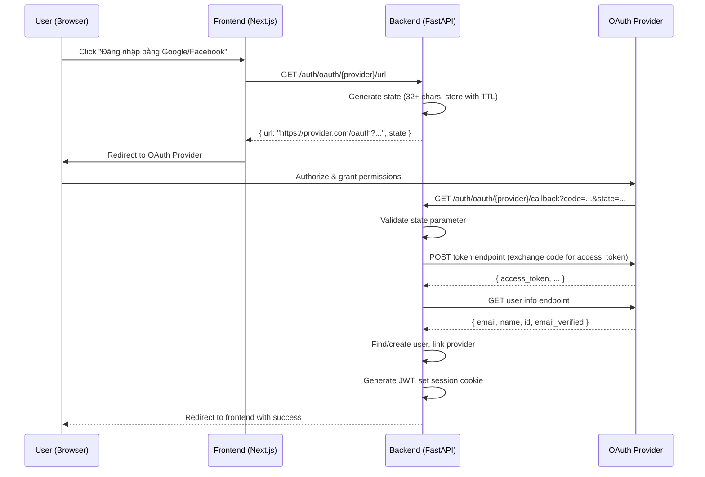
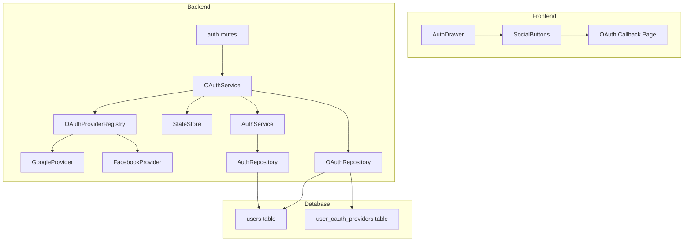
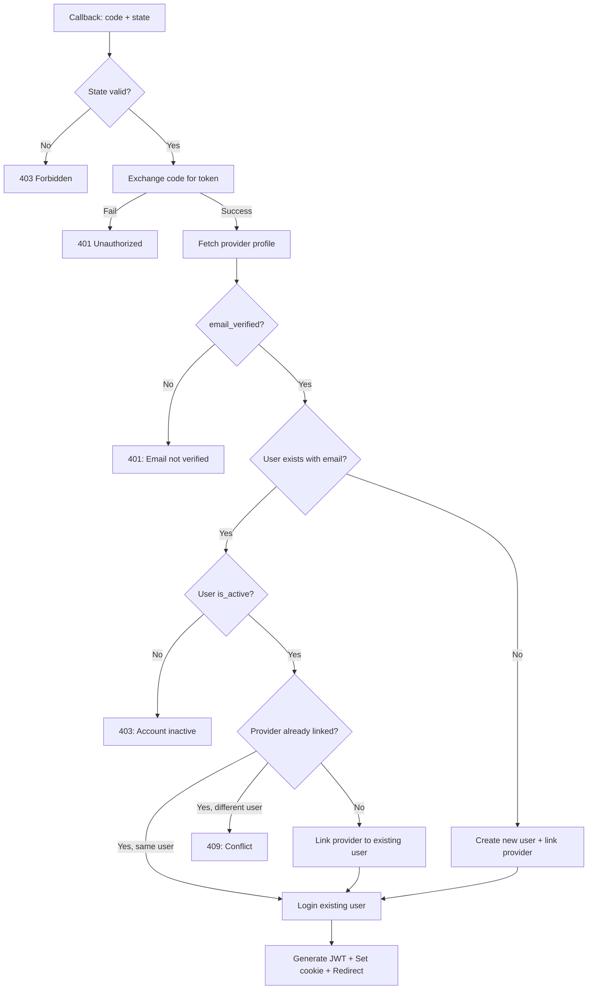

# Design Document: Social Auth Login

## Overview

Tài liệu thiết kế cho tính năng đăng nhập/đăng ký bằng tài khoản mạng xã hội (Google và Facebook) trong ứng dụng SpeakJoy. Tính năng này mở rộng hệ thống xác thực hiện tại (email/password + JWT + session cookie) để hỗ trợ OAuth 2.0 Authorization Code Flow.

### Quyết định thiết kế chính

1. **Server-side OAuth flow**: Toàn bộ quá trình exchange authorization code → access token diễn ra ở backend để bảo vệ client secrets
2. **Tái sử dụng JWT/cookie infrastructure**: OAuth login tạo cùng JWT structure và session cookie như email/password login
3. **Bảng riêng cho OAuth providers**: Sử dụng bảng `user_oauth_providers` thay vì thêm cột vào bảng `users` để hỗ trợ nhiều provider per user
4. **In-memory state store với TTL**: Sử dụng dictionary với TTL 10 phút cho CSRF state (đủ cho single-instance deployment hiện tại)
5. **Auto-linking by email**: Tự động liên kết OAuth provider với tài khoản hiện có nếu email khớp

## Architecture

### Luồng OAuth 2.0 Authorization Code Flow



### Component Architecture



## Components and Interfaces

### Backend Components

#### 1. OAuthService (`be/app/services/oauth_service.py`)

Module chính xử lý logic OAuth flow.

```python
from dataclasses import dataclass
from typing import Literal

OAuthProvider = Literal["google", "facebook"]

@dataclass
class ProviderProfile:
    provider: OAuthProvider
    provider_user_id: str
    email: str
    email_verified: bool
    display_name: str
    avatar_url: str | None

class OAuthService:
    def generate_auth_url(self, provider: OAuthProvider) -> tuple[str, str]:
        """Generate OAuth authorization URL and state parameter.
        Returns: (authorization_url, state)
        """
        ...

    def handle_callback(self, provider: OAuthProvider, code: str, state: str) -> AuthResult:
        """Process OAuth callback: validate state, exchange code, fetch profile,
        find/create user, return AuthResult.
        """
        ...

    def _exchange_code_for_token(self, provider: OAuthProvider, code: str) -> str:
        """Exchange authorization code for provider access token."""
        ...

    def _fetch_provider_profile(self, provider: OAuthProvider, access_token: str) -> ProviderProfile:
        """Fetch user profile from OAuth provider."""
        ...

    def _find_or_create_user(self, profile: ProviderProfile) -> UserEntity:
        """Find existing user by email or create new one. Link OAuth provider."""
        ...
```

#### 2. OAuthProviderRegistry (`be/app/services/oauth_providers.py`)

Cấu hình và URL builder cho từng OAuth provider.

```python
@dataclass
class OAuthProviderConfig:
    client_id: str
    client_secret: str
    authorize_url: str
    token_url: str
    userinfo_url: str
    scopes: list[str]
    redirect_uri: str

class GoogleOAuthProvider:
    AUTHORIZE_URL = "https://accounts.google.com/o/oauth2/v2/auth"
    TOKEN_URL = "https://oauth2.googleapis.com/token"
    USERINFO_URL = "https://www.googleapis.com/oauth2/v2/userinfo"
    SCOPES = ["email", "profile"]

class FacebookOAuthProvider:
    AUTHORIZE_URL = "https://www.facebook.com/v19.0/dialog/oauth"
    TOKEN_URL = "https://graph.facebook.com/v19.0/oauth/access_token"
    USERINFO_URL = "https://graph.facebook.com/v19.0/me?fields=id,name,email,picture"
    SCOPES = ["email", "public_profile"]
```

#### 3. StateStore (`be/app/services/oauth_state_store.py`)

In-memory store cho CSRF state parameters với TTL.

```python
import secrets
import time
from threading import Lock

STATE_TTL_SECONDS = 600  # 10 minutes
STATE_MIN_LENGTH = 32

class OAuthStateStore:
    def __init__(self) -> None:
        self._store: dict[str, float] = {}  # state -> created_at timestamp
        self._lock = Lock()

    def generate(self) -> str:
        """Generate cryptographically random state, store with timestamp."""
        state = secrets.token_urlsafe(32)  # 43 chars base64
        with self._lock:
            self._cleanup_expired()
            self._store[state] = time.time()
        return state

    def validate_and_consume(self, state: str) -> bool:
        """Validate state exists and is not expired. Consume on success."""
        with self._lock:
            created_at = self._store.pop(state, None)
            if created_at is None:
                return False
            if time.time() - created_at > STATE_TTL_SECONDS:
                return False
            return True

    def _cleanup_expired(self) -> None:
        """Remove expired entries."""
        now = time.time()
        expired = [k for k, v in self._store.items() if now - v > STATE_TTL_SECONDS]
        for k in expired:
            del self._store[k]
```

#### 4. OAuth Routes (`be/app/api/routes/auth.py` - mở rộng)

```python
@router.get("/oauth/{provider}/url")
def oauth_get_url(provider: str) -> JSONResponse:
    """Generate OAuth authorization URL for the specified provider."""
    ...

@router.get("/oauth/{provider}/callback")
def oauth_callback(provider: str, code: str, state: str) -> Response:
    """Handle OAuth callback, authenticate user, redirect to frontend."""
    ...
```

#### 5. OAuthRepository (`be/app/repositories/oauth_repository.py`)

Tầng truy cập dữ liệu cho bảng `user_oauth_providers`.

```python
@dataclass
class OAuthProviderEntity:
    id: str
    user_id: str
    provider: str
    provider_user_id: str
    created_at: datetime
    updated_at: datetime

def find_by_provider_and_user_id(provider: str, provider_user_id: str) -> OAuthProviderEntity | None:
    ...

def find_by_user_id(user_id: str) -> list[OAuthProviderEntity]:
    ...

def create_oauth_link(*, user_id: str, provider: str, provider_user_id: str) -> OAuthProviderEntity:
    ...

def find_by_provider_and_email(provider: str, email: str) -> OAuthProviderEntity | None:
    """Find OAuth link by provider type for a user with given email."""
    ...
```

### Frontend Components

#### 6. SocialLoginButtons (`fe/features/auth/components/SocialLoginButtons.tsx`)

Component hiển thị nút đăng nhập Google/Facebook.

```typescript
interface SocialLoginButtonsProps {
  disabled?: boolean;
  onOAuthStart?: (provider: "google" | "facebook") => void;
  onOAuthError?: (error: string) => void;
}

export function SocialLoginButtons({ disabled, onOAuthStart, onOAuthError }: SocialLoginButtonsProps): JSX.Element;
```

#### 7. OAuth Callback Page (`fe/app/(auth)/oauth/callback/page.tsx`)

Page xử lý redirect từ backend sau OAuth flow thành công/thất bại.

```typescript
// URL: /oauth/callback?status=success hoặc /oauth/callback?status=error&message=...
export default function OAuthCallbackPage(): JSX.Element;
```

### Config Extension (`be/app/core/config.py`)

```python
# Thêm vào Settings class
google_client_id: str | None = Field(default=None, alias="GOOGLE_CLIENT_ID")
google_client_secret: str | None = Field(default=None, alias="GOOGLE_CLIENT_SECRET")
facebook_client_id: str | None = Field(default=None, alias="FACEBOOK_CLIENT_ID")
facebook_client_secret: str | None = Field(default=None, alias="FACEBOOK_CLIENT_SECRET")
oauth_redirect_base_url: str | None = Field(default=None, alias="OAUTH_REDIRECT_BASE_URL")
```

## Data Models

### Bảng `user_oauth_providers` (mới)

```sql
CREATE TABLE user_oauth_providers (
    id UUID PRIMARY KEY DEFAULT gen_random_uuid(),
    user_id UUID NOT NULL REFERENCES users(id) ON DELETE CASCADE,
    provider VARCHAR(20) NOT NULL,          -- 'google' | 'facebook'
    provider_user_id VARCHAR(255) NOT NULL,  -- ID từ OAuth provider
    created_at TIMESTAMPTZ NOT NULL DEFAULT NOW(),
    updated_at TIMESTAMPTZ NOT NULL DEFAULT NOW(),

    UNIQUE(provider, provider_user_id),     -- Mỗi provider account chỉ link 1 user
    UNIQUE(user_id, provider)               -- Mỗi user chỉ link 1 account per provider
);

CREATE INDEX idx_oauth_providers_user_id ON user_oauth_providers(user_id);
CREATE INDEX idx_oauth_providers_lookup ON user_oauth_providers(provider, provider_user_id);
```

### Mở rộng bảng `users`

Bảng `users` hiện tại giữ nguyên. Cột `password_hash` sẽ cho phép NULL cho users tạo qua OAuth (không có password):

```sql
ALTER TABLE users ALTER COLUMN password_hash DROP NOT NULL;
```

### Entity Models

```python
# Mở rộng UserEntity - password_hash có thể None
@dataclass(slots=True)
class UserEntity:
    id: str
    email: str
    username: str | None
    password_hash: str | None  # None cho OAuth-only users
    display_name: str
    role: UserRole
    is_active: bool
    last_login_at: datetime | None
    created_at: datetime
    updated_at: datetime

@dataclass(slots=True)
class OAuthProviderEntity:
    id: str
    user_id: str
    provider: str  # "google" | "facebook"
    provider_user_id: str
    created_at: datetime
    updated_at: datetime
```

### API Response Models

```python
class OAuthUrlResponse(BaseModel):
    url: str
    state: str

class AvailableProvidersResponse(BaseModel):
    google: bool
    facebook: bool
```

### Luồng dữ liệu OAuth Callback



## Correctness Properties

*A property is a characteristic or behavior that should hold true across all valid executions of a system — essentially, a formal statement about what the system should do. Properties serve as the bridge between human-readable specifications and machine-verifiable correctness guarantees.*

### Property 1: OAuth URL chứa đầy đủ parameters

*For any* valid OAuth provider configuration (client_id, redirect_uri, scopes), the generated authorization URL SHALL contain all required OAuth 2.0 parameters: client_id, redirect_uri, scope, state, and response_type=code.

**Validates: Requirements 1.1, 1.2, 1.3**

### Property 2: State validation chỉ chấp nhận state khớp chính xác

*For any* two state strings s1 (stored) and s2 (incoming), the state validator SHALL accept if and only if s1 equals s2 exactly. Any non-matching state SHALL result in rejection.

**Validates: Requirements 2.2, 2.3**

### Property 3: Tạo user mới qua OAuth bảo toàn thông tin provider

*For any* valid ProviderProfile với email chưa tồn tại trong hệ thống, the created user SHALL have email matching the profile email, display_name matching the profile name, role="parent", and the OAuth provider data (provider type + provider_user_id) SHALL be stored and retrievable.

**Validates: Requirements 3.1, 3.4, 5.2**

### Property 4: JWT structure nhất quán giữa các phương thức xác thực

*For any* user authenticated via OAuth, the generated JWT SHALL contain the same claims (sub, email, role, iat, exp) with the same semantics as a JWT generated via email/password authentication for the same user.

**Validates: Requirements 3.2**

### Property 5: OAuth login cho user hiện có trả về token hợp lệ

*For any* existing active user whose email matches the OAuth provider profile email, the OAuth login flow SHALL produce a valid Access_Token with sub equal to the user's ID.

**Validates: Requirements 4.1**

### Property 6: User inactive bị từ chối đăng nhập OAuth

*For any* user with is_active=false, attempting OAuth login with a matching provider profile email SHALL result in rejection with status 403, regardless of the provider or profile data.

**Validates: Requirements 4.4**

### Property 7: Account linking bảo toàn khả năng đăng nhập cả hai phương thức

*For any* user có cả email/password và OAuth provider linked, the system SHALL successfully authenticate via email/password login AND via OAuth login, both producing valid Access_Tokens for the same user ID.

**Validates: Requirements 5.3**

### Property 8: State parameter đủ độ dài và entropy

*For any* invocation of the state generator, the output SHALL be at least 32 characters long and cryptographically random (generated from a CSPRNG source).

**Validates: Requirements 7.3**

### Property 9: State parameter hết hạn sau 10 phút

*For any* state parameter, it SHALL be accepted when validated within 10 minutes of generation, and SHALL be rejected when validated after 10 minutes have elapsed.

**Validates: Requirements 7.4**

### Property 10: Redirect URI validation chỉ chấp nhận URI đã cấu hình

*For any* redirect_uri string, the validator SHALL accept only URIs that exactly match one of the configured allowed redirect URIs, and SHALL reject all others.

**Validates: Requirements 7.5**

### Property 11: Email chưa verified bị từ chối

*For any* OAuth provider profile where email_verified is false, the authentication flow SHALL reject the request with status 401, regardless of whether the email exists in the system.

**Validates: Requirements 7.6**

## Error Handling

### Backend Error Cases

| Tình huống | HTTP Status | Error Message | Hành động |
|---|---|---|---|
| Provider không hợp lệ | 400 | "Unsupported OAuth provider" | Return error |
| Provider bị disable (thiếu credentials) | 400 | "Provider is not configured" | Return error |
| State không khớp hoặc hết hạn | 403 | "Invalid or expired OAuth state" | Return error |
| Code exchange thất bại | 401 | "Failed to authenticate with provider" | Return error |
| Email chưa verified | 401 | "Email not verified by provider" | Return error |
| User inactive | 403 | "User is inactive" | Return error |
| Provider đã linked user khác | 409 | "Provider account already linked to another user" | Return error |
| Network error khi gọi provider | 502 | "OAuth provider unavailable" | Return error, log |

### Frontend Error Handling

- OAuth redirect thất bại → Hiển thị error message trong AuthDrawer status area
- Callback page nhận error → Redirect về login page với error query param
- Network timeout → Hiển thị "Không thể kết nối" message

### Error Flow Integration

Tất cả OAuth errors sử dụng cùng `AuthError` exception class hiện có:

```python
# Tái sử dụng pattern hiện tại
raise AuthError(status_code=403, message="Invalid or expired OAuth state")
```

Frontend xử lý errors qua cùng status display mechanism trong AuthDrawer.

## Testing Strategy

### Unit Tests (pytest)

- **OAuthService**: Test logic find_or_create_user với mock repository
- **StateStore**: Test generate, validate, expiry, cleanup
- **OAuthProviderRegistry**: Test URL generation, config validation
- **OAuthRepository**: Test CRUD operations với test database

### Property-Based Tests (Hypothesis)

Sử dụng thư viện **Hypothesis** cho Python property-based testing.

Cấu hình:
- Minimum 100 iterations per property (`@settings(max_examples=100)`)
- Mỗi test có comment tag: `# Feature: social-auth-login, Property {N}: {description}`

Properties cần implement:
1. OAuth URL parameter completeness (Property 1)
2. State validation correctness (Property 2)
3. User creation data preservation (Property 3)
4. JWT structure consistency (Property 4)
5. Existing user OAuth login (Property 5)
6. Inactive user rejection (Property 6)
7. Dual auth method after linking (Property 7)
8. State parameter length/entropy (Property 8)
9. State parameter TTL (Property 9)
10. Redirect URI validation (Property 10)
11. Unverified email rejection (Property 11)

### Integration Tests

- Full OAuth flow với mocked provider endpoints (httpx mock)
- Database integration: tạo user, link provider, query
- Cookie/JWT verification end-to-end

### Frontend Tests (Jest/React Testing Library)

- SocialLoginButtons render trong cả login/register modes
- Loading state khi OAuth flow đang chạy
- Error display khi OAuth thất bại
- Conditional rendering khi provider bị disable

### Environment cho Testing

```
# Test .env
GOOGLE_CLIENT_ID=test-google-client-id
GOOGLE_CLIENT_SECRET=test-google-client-secret
FACEBOOK_CLIENT_ID=test-facebook-client-id
FACEBOOK_CLIENT_SECRET=test-facebook-client-secret
OAUTH_REDIRECT_BASE_URL=http://localhost:4000
```
