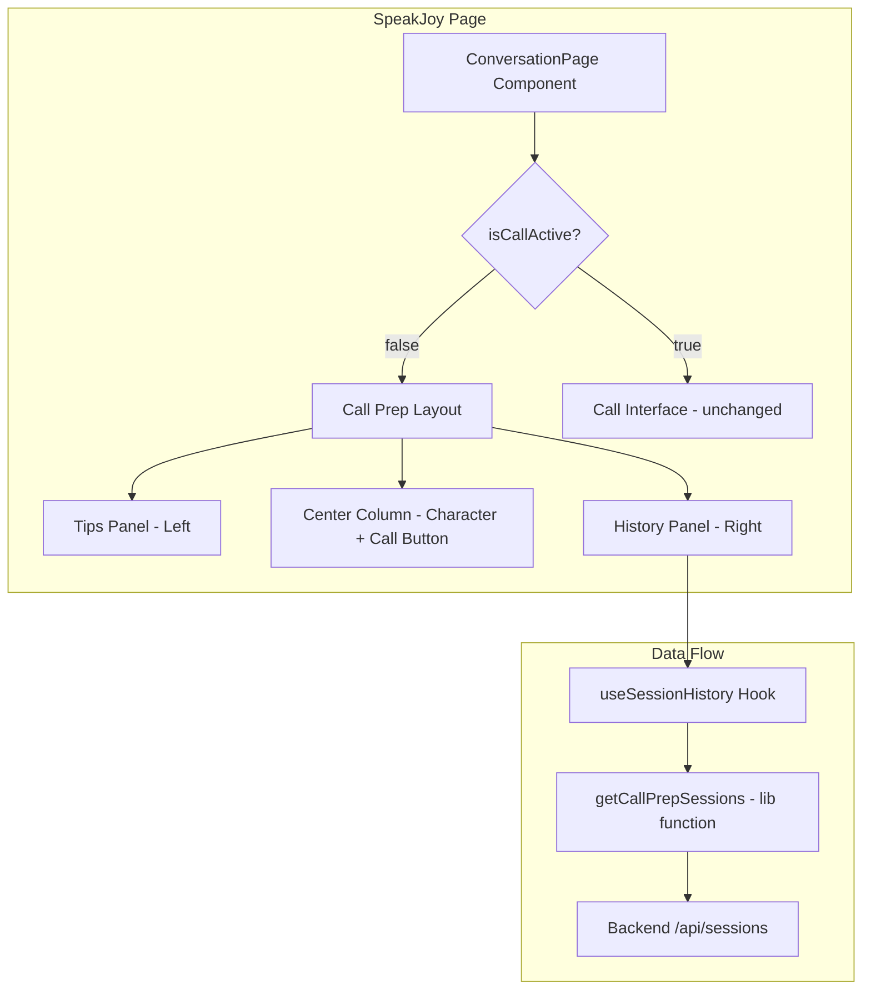

# Design Document: SpeakJoy Call Prep UI

## Overview

This design adds two informational panels to the SpeakJoy call preparation page, transforming the existing single-column centered layout into a three-column arrangement. The **Tips/Notes Panel** appears on the left providing guidance cards, and the **Conversation History Panel** appears on the right showing past sessions grouped by date. Both panels are visible only in the idle (pre-call) state and hide when a call becomes active.

The implementation leverages the existing Next.js frontend architecture, Framer Motion animations, and the backend sessions API (`/api/sessions`). No backend changes are required — the frontend will consume the existing session data and format it for the history panel.

### Key Design Decisions

1. **Client-side only** — Both panels are purely frontend components. The history panel fetches data from the existing `/api/sessions` endpoint.
2. **Responsive stacking** — Below 1024px viewport width, the layout collapses to a single column with panels stacked vertically.
3. **Local state for tips** — Tip dismissal is managed via React state (not persisted). Tips reappear on page reload.
4. **Reuse existing patterns** — Styling follows the established `bg-black/20 backdrop-blur-md border-purple-700/40` pattern already used in the page header.

## Architecture



The architecture follows a simple component composition pattern:

- **ConversationPage** (existing) — Conditionally renders the call prep layout or the call interface based on `isCallActive`.
- **TipsPanel** — A new component rendering dismissible tip cards with local state.
- **HistoryPanel** — A new component that fetches and displays session history.
- **useSessionHistory** — A new custom hook encapsulating the fetch logic, loading state, and error handling for session data.

## Components and Interfaces

### New Components

#### `TipsPanel`
**Location:** `fe/components/speakjoy/TipsPanel.tsx`

```typescript
interface TipItem {
  id: string;
  icon: string;       // Emoji icon for the tip
  text: string;       // Tip content text
}

interface TipsPanelProps {
  className?: string;
}
```

Responsibilities:
- Renders a vertical list of `TipCard` sub-components
- Manages dismissed tips via `useState<Set<string>>`
- Animates entry with Framer Motion `motion.div` (fade + slide from left)
- Scrollable when content overflows

#### `TipCard`
**Location:** Inline within `TipsPanel.tsx`

```typescript
interface TipCardProps {
  tip: TipItem;
  onDismiss: (id: string) => void;
}
```

Responsibilities:
- Renders a single tip with close (X) button
- Triggers `AnimatePresence` exit animation (fade-out) on dismiss

#### `HistoryPanel`
**Location:** `fe/components/speakjoy/HistoryPanel.tsx`

```typescript
interface HistoryPanelProps {
  className?: string;
}
```

Responsibilities:
- Calls `useSessionHistory` hook to fetch data
- Renders loading, error, empty, and populated states
- Groups sessions by date using relative labels ("Hôm nay", "Hôm qua", date string)
- Scrollable when content overflows
- Animates entry with Framer Motion (fade + slide from right)

#### `SessionEntryRow`
**Location:** Inline within `HistoryPanel.tsx`

```typescript
interface SessionEntryDisplay {
  id: string;
  timestamp: string;        // Formatted time string (e.g., "14:30")
  messageCount: number;     // From turnCount
  duration: string;         // Formatted duration (e.g., "5 phút")
  isIncomplete: boolean;    // true if endedAt is null
}
```

Responsibilities:
- Renders a single session row with timestamp, message count, duration, and status

### New Hook

#### `useSessionHistory`
**Location:** `fe/hooks/useSessionHistory.ts`

```typescript
interface UseSessionHistoryReturn {
  sessions: GroupedSessions[];
  isLoading: boolean;
  error: string | null;
}

interface GroupedSessions {
  label: string;            // "Hôm nay", "Hôm qua", or formatted date
  sessions: SessionEntryDisplay[];
}
```

Responsibilities:
- Fetches sessions from `/api/sessions` using the existing `backendJson` utility
- Transforms raw `BackendSession` data into `SessionEntryDisplay` format
- Groups sessions by calendar date with Vietnamese relative labels
- Handles loading and error states gracefully

### Modified Components

#### `ConversationPage` (existing page)
**Location:** `fe/app/(dashboard)/SpeakJoy/page.tsx`

Changes:
- Wrap the idle-state content in a responsive three-column grid layout
- Import and render `TipsPanel` and `HistoryPanel` flanking the existing center content
- Both panels are conditionally rendered only when `!isCallActive`

## Data Models

### Frontend Types

```typescript
// Tip data (static, defined in component)
interface TipItem {
  id: string;
  icon: string;
  text: string;
}

// Session display model (transformed from BackendSession)
interface SessionEntryDisplay {
  id: string;
  timestamp: string;
  messageCount: number;
  duration: string;
  isIncomplete: boolean;
}

// Grouped sessions for rendering
interface GroupedSessions {
  label: string;
  sessions: SessionEntryDisplay[];
}
```

### Backend Data (existing, no changes)

The existing `BackendSession` type from `fe/lib/backend-sessions.ts` provides:
```typescript
type BackendSession = {
  id: string;
  childId: string | null;
  topicId: string | null;
  status: "active" | "completed" | "abandoned";
  startedAt: string;       // ISO datetime
  endedAt: string | null;  // ISO datetime or null
  turnCount: number;
  overallScore: string | null;
  summary: string | null;
};
```

### Data Transformation Logic

The `useSessionHistory` hook transforms `BackendSession[]` into `GroupedSessions[]`:

1. **Filter** — Include only sessions belonging to the current child (matching existing logic in `backend-sessions.ts`)
2. **Sort** — Order by `startedAt` descending (most recent first)
3. **Compute duration** — If `endedAt` exists: `endedAt - startedAt` formatted as minutes. If null: mark as incomplete.
4. **Group by date** — Compare `startedAt` date to today/yesterday for relative labels, otherwise use formatted date string.
5. **Format timestamp** — Extract time portion (HH:mm) from `startedAt`.

## Correctness Properties

*A property is a characteristic or behavior that should hold true across all valid executions of a system — essentially, a formal statement about what the system should do. Properties serve as the bridge between human-readable specifications and machine-verifiable correctness guarantees.*

### Property 1: Date grouping assigns sessions to correct relative labels

*For any* list of sessions with valid `startedAt` ISO datetime strings, the grouping function SHALL assign each session to the correct date group: sessions from today get label "Hôm nay", sessions from yesterday get label "Hôm qua", and sessions from other dates get a formatted date string. No session shall appear in more than one group, and all input sessions shall appear in exactly one group.

**Validates: Requirements 4.3**

### Property 2: Duration computation correctness

*For any* session with a valid `startedAt` ISO datetime and a valid `endedAt` ISO datetime where `endedAt` > `startedAt`, the computed duration in minutes SHALL equal `Math.floor((endedAt - startedAt) / 60000)`. The result shall always be a non-negative integer.

**Validates: Requirements 5.3**

### Property 3: Timestamp formatting produces valid time string

*For any* valid ISO datetime string, the timestamp formatting function SHALL produce a string containing a valid hour (00-23) and minute (00-59) representation. The formatted output shall never be empty and shall be consistent — calling the function twice with the same input produces the same output.

**Validates: Requirements 5.1**

## Error Handling

| Scenario | Behavior |
|----------|----------|
| Backend API returns HTTP error (4xx/5xx) | History panel shows empty state message; page remains fully functional |
| Backend API is unreachable (network error) | History panel shows empty state message; no error propagation to parent |
| Backend returns empty sessions array | History panel shows "Chưa có lịch sử cuộc trò chuyện" message |
| Session has null `endedAt` | Session entry shows "Chưa hoàn thành" status indicator instead of duration |
| Session has `turnCount` of 0 | Display "0 tin nhắn" — no special handling needed |
| Invalid date in session data | Skip the malformed session entry; do not crash the panel |

Error handling follows the existing pattern in `backend-sessions.ts` where `BackendHttpError` is caught and a fallback empty response is returned. The history panel will never block page rendering or prevent call initiation.

## Testing Strategy

### Unit Tests (Example-Based)

Unit tests cover specific rendering scenarios and user interactions:

- **Layout tests**: Verify three-column layout renders in idle state; verify single-column at <1024px
- **Tips panel**: Verify default tips render; verify dismiss removes card; verify empty state after all dismissed
- **History panel**: Verify title renders; verify loading state; verify empty state; verify error state
- **Session entry**: Verify turnCount display; verify incomplete session indicator
- **Integration**: Verify panels hide when call becomes active

### Property-Based Tests

Property tests verify the pure data transformation functions using `fast-check`:

- **Date grouping** (Property 1): Generate random arrays of sessions with various dates, verify correct group assignment
- **Duration computation** (Property 2): Generate random valid start/end datetime pairs, verify computed duration
- **Timestamp formatting** (Property 3): Generate random valid ISO datetimes, verify output format

**Configuration:**
- Library: `fast-check` (TypeScript property-based testing)
- Minimum iterations: 100 per property
- Tag format: `Feature: speakjoy-call-prep-ui, Property {number}: {property_text}`

### Testing Tools

- **Vitest** — Test runner (to be added to project)
- **fast-check** — Property-based testing library
- **@testing-library/react** — Component rendering and interaction tests

### What Is NOT Tested with PBT

- Layout/CSS behavior (responsive breakpoints, animations) — verified with example-based rendering tests
- API integration (fetch calls, auth tokens) — verified with mocked integration tests
- Visual styling (backdrop blur, border colors) — verified by CSS class assertions
- Framer Motion animations — verified by checking motion props in rendered output

