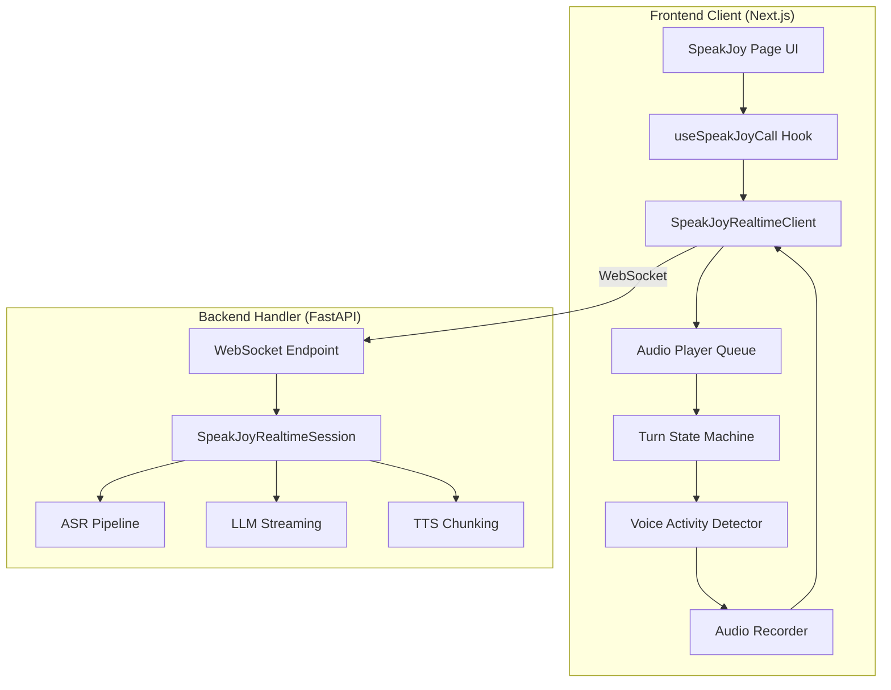
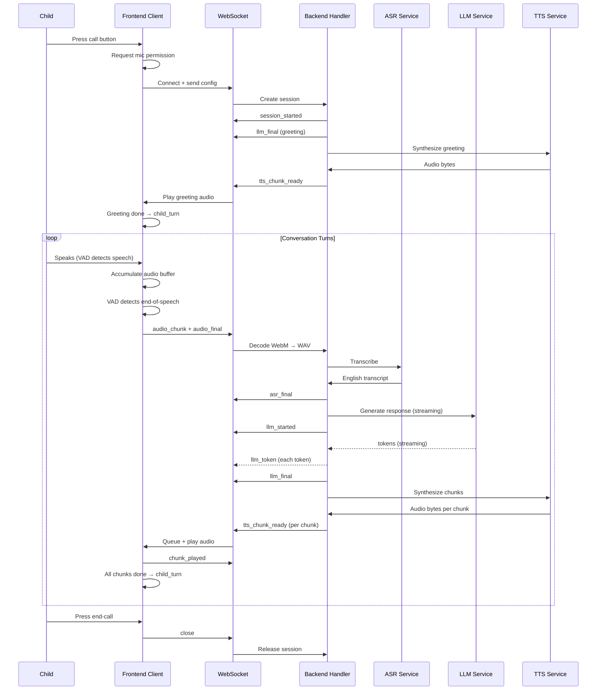
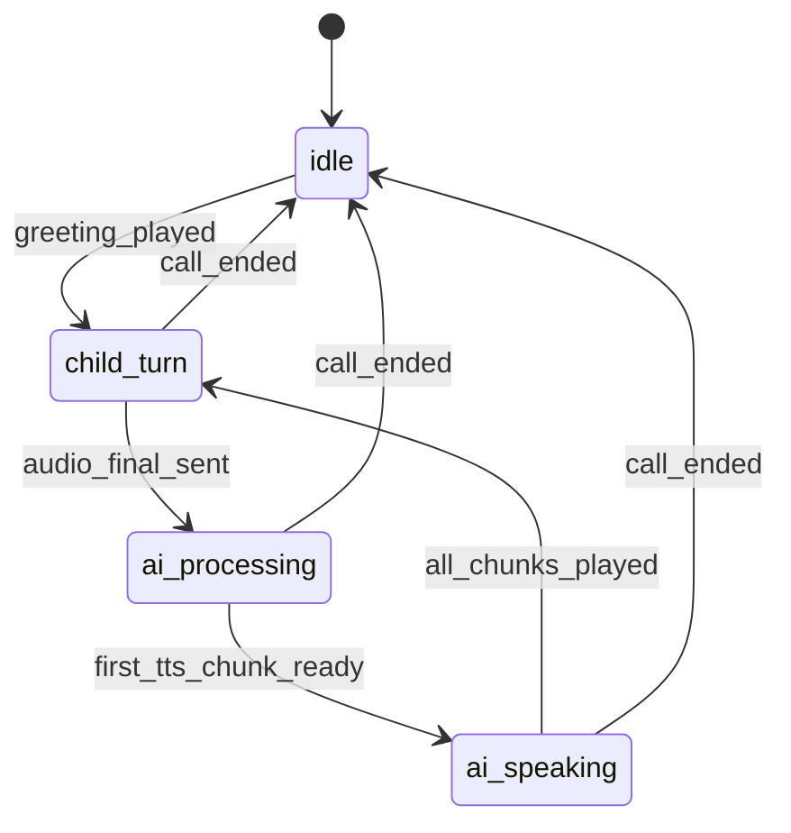

# Design Document: SpeakJoy Freestyle Conversation

## Overview

This design describes the real-time voice conversation system between a child (ages 5–10) and an AI character named Joy. The system orchestrates a full-duplex audio pipeline over WebSocket: the child speaks into a microphone, audio is transcribed via ASR, an LLM generates a contextual response, TTS synthesizes speech, and the result plays back — all while displaying chat bubbles on screen.

The architecture is split into two main layers:

1. **Frontend Client** (Next.js/React): Manages microphone capture, VAD, audio playback, turn-state UI, and WebSocket transport.
2. **Backend Handler** (Python/FastAPI): Orchestrates session lifecycle, ASR decoding, LLM streaming, TTS chunking, and event emission over WebSocket.

Key design goals:
- **Low latency**: Streaming LLM tokens and chunked TTS so the child hears responses quickly.
- **Proper turn-taking**: A state machine ensures only one party speaks at a time, preventing echo and overlap.
- **Child-friendly error recovery**: Failures in any pipeline stage gracefully return control to the child.
- **VAD-driven audio**: Only meaningful speech is sent to the backend, eliminating silence-triggered errors.

## Architecture



### Data Flow Sequence



## Components and Interfaces

### Frontend Components

#### 1. Turn State Machine (`TurnStateMachine`)

Manages the four conversation states and enforces transitions.

```typescript
type TurnState = 'idle' | 'child_turn' | 'ai_processing' | 'ai_speaking';

interface TurnStateMachine {
  currentState: TurnState;
  transition(event: TurnEvent): void;
  onStateChange(callback: (state: TurnState) => void): void;
}

type TurnEvent =
  | 'call_started'        // idle → child_turn (after greeting plays)
  | 'speech_ended'        // child_turn → ai_processing
  | 'tts_playback_start'  // ai_processing → ai_speaking
  | 'tts_playback_done'   // ai_speaking → child_turn
  | 'call_ended';         // any → idle
```

#### 2. Voice Activity Detector (`VADController`)

Client-side amplitude monitoring to detect speech boundaries.

```typescript
interface VADConfig {
  speechThresholdDb: number;       // Amplitude threshold (default: -40dB)
  speechOnsetMs: number;           // Min duration to classify as speech (200ms)
  silenceDurationMs: number;       // Silence before end-of-speech (1500ms)
  maxSegmentDurationMs: number;    // Force end-of-speech at 30s
  minSegmentDurationMs: number;    // Discard segments < 300ms
}

interface VADController {
  start(stream: MediaStream): void;
  stop(): void;
  onSpeechStart(callback: () => void): void;
  onSpeechEnd(callback: (audioBuffer: Blob) => void): void;
  onAmplitudeChange(callback: (db: number) => void): void;
}
```

#### 3. Audio Recorder (`AudioRecorder`)

Captures microphone audio with proper encoding.

```typescript
interface AudioRecorderConfig {
  channelCount: 1;
  sampleRate: 16000;
  echoCancellation: true;
  noiseSuppression: true;
  mimeType: 'audio/webm;codecs=opus';
}

interface AudioRecorder {
  start(stream: MediaStream): void;
  stop(): Blob;
  getBuffer(): Blob;
  isRecording: boolean;
}
```

#### 4. Audio Player Queue (`AudioPlayerQueue`)

Sequential playback of TTS chunks with completion signaling.

```typescript
interface AudioChunk {
  index: number;
  text: string;
  audioBlob: Blob;
}

interface AudioPlayerQueue {
  enqueue(chunk: AudioChunk): void;
  play(): void;
  stop(): void;
  onChunkPlayed(callback: (index: number) => void): void;
  onAllPlayed(callback: () => void): void;
  onError(callback: (index: number, error: Error) => void): void;
}
```

#### 5. WebSocket Client (`SpeakJoyRealtimeClient`)

Transport layer handling connection lifecycle, reconnection, and message serialization.

```typescript
interface ClientToServerMessage {
  type: 'config' | 'audio_chunk' | 'audio_final' | 'chunk_played' | 'ping' | 'close';
  payload?: SpeakJoyConfig;
  data?: string;          // base64 audio
  chunk_index?: number;
}

interface ServerToClientMessage {
  type: 'ready' | 'session_started' | 'asr_partial' | 'asr_final' |
        'llm_started' | 'llm_token' | 'llm_final' |
        'tts_text_ready' | 'tts_chunk_ready' |
        'turn_closed' | 'error' | 'pong';
  payload?: Record<string, any>;
  message?: string;
}
```

### Backend Components

#### 6. WebSocket Endpoint (`websocket_speakjoy_realtime`)

FastAPI WebSocket handler that bridges transport to the session coordinator.

```python
# Responsibilities:
# - Accept WebSocket connection, send "ready"
# - Parse config message, create SpeakJoyRealtimeSession
# - Accumulate audio_chunk bytes into buffer
# - On audio_final: decode WebM→WAV, run ASR, push to session
# - Stream session events back to client
# - Handle ping/pong keepalive
# - Clean up on close/disconnect
```

#### 7. Session Coordinator (`SpeakJoyRealtimeSession`)

Transport-agnostic orchestrator managing the conversation pipeline.

```python
@dataclass
class SpeakJoyRealtimeSession:
    config: SpeakJoyConfig
    transcript: RealtimeTranscriptState
    tts_buffer: TtsPlaybackBuffer
    history: list[dict[str, str]]
    event_queue: asyncio.Queue[SpeakJoyEvent]

    async def push_asr_partial(self, partial: SpeakJoyAsrPartial) -> None: ...
    async def mark_tts_chunk_played(self, chunk_index: int) -> None: ...
    async def close(self) -> None: ...
    async def events(self) -> AsyncGenerator[SpeakJoyEvent, None]: ...
```

#### 8. ASR Pipeline

Decodes WebM/Opus audio to 16kHz mono WAV and transcribes via the ASR service with English language explicitly set.

#### 9. LLM Streaming

Streams tokens from the LLM with a system prompt tailored for Joy's character (simple English, 2 sentences max, ends with a question).

#### 10. TTS Chunking

Splits LLM output into word-count-based chunks (default 4 words) and synthesizes each chunk independently for low-latency playback.

### WebSocket Protocol Summary

| Direction | Message Type | Payload | Purpose |
|-----------|-------------|---------|---------|
| C→S | `config` | `{child_name, child_age, topic_name, vocabulary, ...}` | Initialize session |
| C→S | `audio_chunk` | `{data: base64}` | Stream audio segment |
| C→S | `audio_final` | — | Signal end-of-speech |
| C→S | `chunk_played` | `{chunk_index: N}` | Confirm TTS chunk played |
| C→S | `ping` | — | Keepalive |
| C→S | `close` | — | End session |
| S→C | `ready` | `{message}` | Server ready |
| S→C | `session_started` | `{child_name, child_age, topic_name}` | Session created |
| S→C | `asr_partial` | `{text, words}` | Partial transcript |
| S→C | `asr_final` | `{text, reason}` | Final transcript |
| S→C | `llm_started` | `{message}` | LLM generation begun |
| S→C | `llm_token` | `{token, text}` | Streaming token |
| S→C | `llm_final` | `{text}` | Complete response |
| S→C | `tts_text_ready` | `{chunk_index, text}` | TTS text queued |
| S→C | `tts_chunk_ready` | `{chunk_index, text, audio_base64}` | TTS audio ready |
| S→C | `turn_closed` | `{reason}` | Turn complete |
| S→C | `error` | `{message}` | Error occurred |
| S→C | `pong` | — | Keepalive response |

## Data Models

### Frontend State

```typescript
// Turn State Machine state
interface ConversationState {
  turnState: 'idle' | 'child_turn' | 'ai_processing' | 'ai_speaking';
  isConnected: boolean;
  isCallActive: boolean;
  callStartTime: number | null;
}

// Message model for display
interface ChatMessage {
  id: string;
  role: 'user' | 'assistant';
  content: string;
  timestamp: number;
  audioUrl?: string;
}

// VAD state
interface VADState {
  isSpeechActive: boolean;
  currentAmplitudeDb: number;
  speechStartTime: number | null;
  silenceStartTime: number | null;
}

// Session configuration sent to backend
interface SessionConfig {
  child_name: string;
  child_age: number;
  child_id?: string;
  topic_name?: string;
  vocabulary?: string[];
  pause_after_ms?: number;        // default 1500
  tts_words_per_chunk?: number;   // default 4
}
```

### Backend State

```python
@dataclass
class SpeakJoyConfig:
    child_age: int = 7
    child_name: str = "friend"
    child_id: str = ""
    topic_name: str = ""
    vocabulary: list[str] = field(default_factory=list)
    pause_after_ms: int = 500
    tts_words_per_chunk: int = 4

@dataclass
class RealtimeTranscriptState:
    partial_text: str = ""
    committed_text: str = ""
    last_partial_at: float = 0.0
    last_commit_at: float = 0.0

@dataclass
class TtsPlaybackBuffer:
    pending_chunks: list[SpeakJoyTtsChunk] = field(default_factory=list)
    next_chunk_index: int = 0

@dataclass
class SpeakJoyEvent:
    type: str  # One of the event types
    payload: dict[str, Any]

# Conversation history entry
HistoryEntry = TypedDict('HistoryEntry', {'role': str, 'content': str})
# role: "user" | "bot"
```

### Turn State Machine Transitions



## Correctness Properties

*A property is a characteristic or behavior that should hold true across all valid executions of a system — essentially, a formal statement about what the system should do. Properties serve as the bridge between human-readable specifications and machine-verifiable correctness guarantees.*

### Property 1: Turn State Machine Invariant and Valid Transitions

*For any* sequence of turn events applied to the Turn State Machine, the machine SHALL always be in exactly one of the four valid states (idle, child_turn, ai_processing, ai_speaking), and transitions SHALL only follow the defined edges: idle→child_turn (on greeting_played), child_turn→ai_processing (on audio_final_sent), ai_processing→ai_speaking (on first_tts_chunk_ready), ai_speaking→child_turn (on all_chunks_played), and any→idle (on call_ended). The audio recorder SHALL be disabled whenever the state is ai_processing or ai_speaking.

**Validates: Requirements 4.1, 4.2, 4.3, 4.4, 4.5, 4.6, 4.7, 4.8, 2.4, 8.6**

### Property 2: VAD Speech Classification

*For any* audio amplitude sequence, the VAD SHALL classify the input as active speech if and only if the amplitude exceeds the speech threshold continuously for at least 200 milliseconds, and SHALL classify the input as end-of-speech if and only if the amplitude remains below the speech threshold for at least the configured silence duration (default 1500ms). Segments shorter than 300ms SHALL be discarded.

**Validates: Requirements 3.2, 3.4, 5.4**

### Property 3: TTS Text Chunking

*For any* non-empty text string and a configured words-per-chunk value N, the `_split_tts_chunks` function SHALL produce chunks where each chunk contains exactly N words (except possibly the last chunk which may contain fewer), and the concatenation of all chunks (joined by spaces) SHALL equal the normalized input text.

**Validates: Requirements 8.1**

### Property 4: LLM Token Streaming Round-Trip

*For any* sequence of tokens emitted by the LLM stream, the text in the llm_final event SHALL equal the normalized concatenation of all emitted tokens, and each intermediate llm_token event SHALL contain accumulated text that is a prefix of the final text.

**Validates: Requirements 7.4, 7.5**

### Property 5: Session Creation and Personalized Greeting

*For any* valid SpeakJoyConfig containing a child_name and optional topic_name, session creation SHALL produce a session_started event with matching config fields, and the generated greeting SHALL contain the child's name. If a topic_name is provided, the greeting SHALL also reference the topic.

**Validates: Requirements 1.3, 2.1**

### Property 6: Conversation History Invariant

*For any* sequence of completed conversation turns (user message followed by bot response), the session's history list SHALL contain all messages in chronological order, with each entry having a role ("user" or "bot") and non-empty content matching the original message.

**Validates: Requirements 11.1**

### Property 7: History Context Window

*For any* conversation history of length L, when generating an LLM response, the system SHALL pass at most the last 10 messages as context. If L ≤ 10, all messages are included; if L > 10, only the most recent 10 are included.

**Validates: Requirements 11.2**

### Property 8: Message Display Consistency

*For any* asr_final event with text T received by the frontend, a user chat message with content T SHALL be added to the messages array. For any llm_final event with text T, an assistant chat message with content T SHALL be added. Messages SHALL appear in the order events are received.

**Validates: Requirements 9.1, 9.2**

### Property 9: Error Recovery Guarantee

*For any* failure in the ASR, LLM, or TTS pipeline during a conversation turn, the session SHALL emit an error event followed by a turn_closed event, ensuring the child's turn is re-enabled and the system does not deadlock.

**Validates: Requirements 10.1, 6.4, 6.5, 7.6**

### Property 10: Audio Queue Sequential Playback with Skip-on-Error

*For any* sequence of TTS audio chunks enqueued for playback, the Audio Player SHALL play them in chunk_index order. If a chunk fails to play, it SHALL be skipped and playback SHALL continue with the next chunk. When all chunks have been played (or skipped), the completion signal SHALL be emitted.

**Validates: Requirements 8.4, 10.4**

## Error Handling

### Frontend Error Handling

| Error Scenario | Handling Strategy |
|---|---|
| Microphone permission denied | Display error message, remain in idle state, do not attempt WebSocket connection |
| WebSocket connection failure | Display reconnecting indicator, retry up to 3 times with exponential backoff (1s, 2s, 4s) |
| Reconnection exhausted | Display "connection lost" message, return to idle state |
| TTS chunk playback failure | Skip failed chunk, continue with next queued chunk, log error |
| Invalid server message | Log warning, ignore message, continue operation |
| Browser autoplay blocked | Queue audio, attempt play on next user interaction |

### Backend Error Handling

| Error Scenario | Handling Strategy |
|---|---|
| Invalid config message | Send error event with descriptive message |
| Audio decode failure (WebM→WAV) | Send error event + turn_closed, clear audio buffer |
| ASR service failure | Send error event with child-friendly message + turn_closed |
| ASR returns empty transcript | Send turn_closed (no error), re-enable child's turn |
| LLM service failure | Send error event + turn_closed |
| TTS service failure | Send error event + turn_closed |
| WebSocket disconnect | Cancel all pending tasks, release session resources |
| Audio too short (<300ms) | Send validation error, clear buffer |
| Audio too quiet (peak < 0.001) | Send "speak louder" error, clear buffer |

### Error Message Design

All error messages displayed to the child are:
- Written in simple, non-technical language
- Displayed as non-blocking toasts that auto-dismiss after 5 seconds
- Actionable (e.g., "Please try speaking again" rather than "ASR failed")

### Graceful Degradation

- If TTS fails for a greeting, the text is still displayed (conversation continues without audio)
- If a single TTS chunk fails mid-response, remaining chunks still play
- If the LLM produces no response, a turn_closed event re-enables the child without error display

## Testing Strategy

### Property-Based Tests (using fast-check for TypeScript, Hypothesis for Python)

Property-based testing is appropriate for this feature because it contains significant pure logic:
- Turn state machine transitions (finite state machine with defined transitions)
- VAD classification logic (threshold-based decisions on amplitude data)
- TTS text chunking (pure string splitting algorithm)
- Token accumulation (string concatenation invariants)
- History windowing (array slicing logic)

**Configuration**: Each property test runs a minimum of 100 iterations.

**Tag format**: `Feature: speakjoy-freestyle-conversation, Property {N}: {description}`

**Frontend (TypeScript with fast-check)**:
- Property 1: Turn state machine invariant (generate random event sequences)
- Property 2: VAD classification (generate random amplitude arrays)
- Property 8: Message display consistency (generate random event payloads)
- Property 10: Audio queue resilience (generate random chunk sequences with failures)

**Backend (Python with Hypothesis)**:
- Property 3: TTS text chunking (`_split_tts_chunks` with random text and chunk sizes)
- Property 4: LLM token streaming round-trip (mock LLM with random token sequences)
- Property 5: Session creation and greeting (random configs)
- Property 6: Conversation history invariant (random message sequences)
- Property 7: History context window (random history lengths)
- Property 9: Error recovery guarantee (inject failures at random pipeline stages)

### Unit Tests (Example-Based)

- WebSocket connection lifecycle (connect, config, close)
- Reconnection logic (3 attempts with backoff)
- Microphone permission denial handling
- Audio encoding format verification (WebM/Opus, mono, 16kHz)
- Base64 encoding/decoding of audio chunks
- Greeting generation with various name/topic combinations
- ASR empty transcript handling
- Call duration timer accuracy
- UI state indicators matching turn state

### Integration Tests

- Full conversation turn: audio → ASR → LLM → TTS → playback
- WebSocket message serialization/deserialization
- Audio decode pipeline (WebM/Opus → 16kHz WAV)
- Session cleanup on disconnect
- Concurrent session handling

### Edge Case Tests

- Microphone permission denied
- No speech for 10 seconds (silence timeout)
- Audio segment exceeds 30 seconds (auto-trigger)
- Audio segment shorter than 300ms (discard)
- ASR returns empty transcript
- LLM/TTS service timeout
- WebSocket disconnect during AI response
- Browser autoplay policy blocking audio

