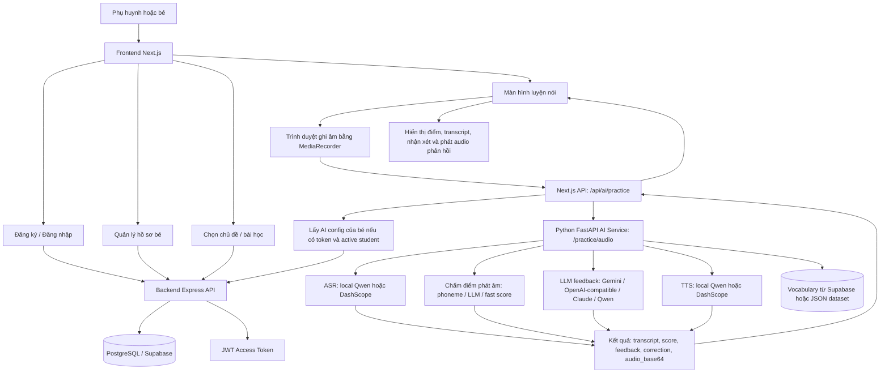
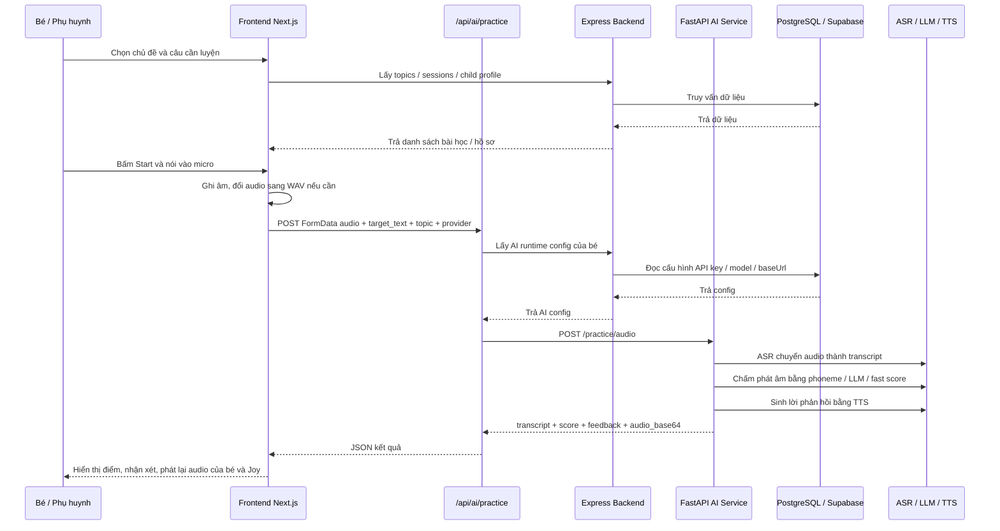
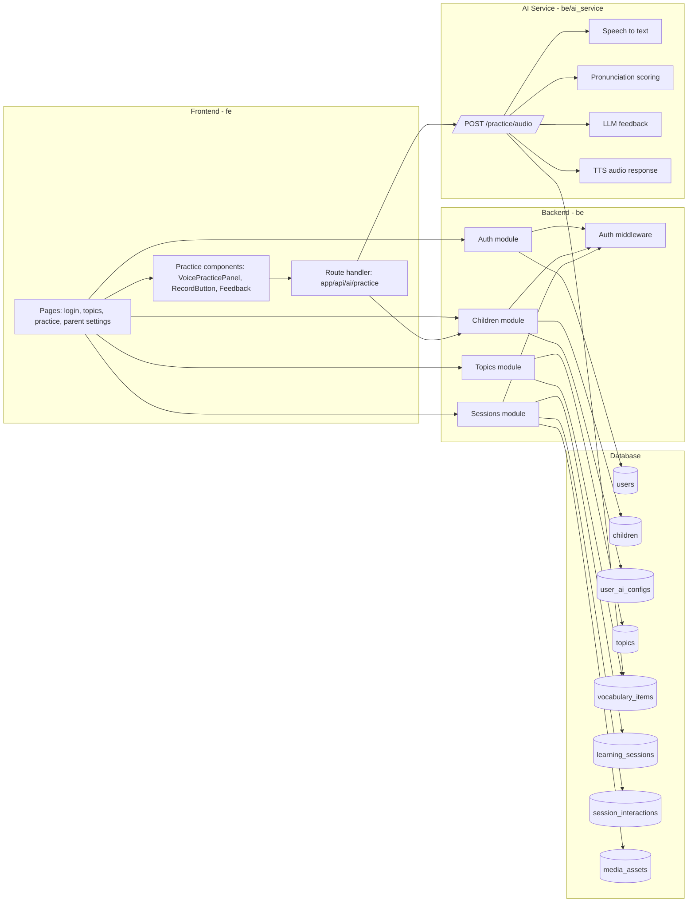

# Sơ Đồ Luồng Hoạt Động Speak Joy

Tài liệu này mô tả luồng hoạt động chính của hệ thống Speak Joy dựa trên cấu trúc hiện tại của dự án.

## Ảnh Sơ Đồ

## 1. Tổng Quan Hệ Thống

## 2. Luồng Luyện Nói

## 3. Luồng Dữ Liệu Chính

## 4. Các Thành Phần Chính

- Frontend: ứng dụng Next.js trong thư mục `fe`, phụ trách giao diện, ghi âm, gọi API và hiển thị kết quả luyện nói.
- Backend: Express API trong thư mục `be/src`, phụ trách xác thực, hồ sơ bé, chủ đề, phiên học và kết nối database.
- Database: PostgreSQL / Supabase, được mô tả trong `be/prisma/schema.prisma`.
- AI Service: FastAPI trong `be/ai_service`, phụ trách nhận audio, ASR, chấm phát âm, gọi LLM và tạo audio phản hồi.
- Next.js AI Proxy: route `fe/app/api/ai/practice/route.ts`, dùng để bổ sung AI config của bé trước khi gọi AI service.

## 5. File Tham Chiếu

- `be/src/app.ts`: định nghĩa route backend chính.
- `be/src/modules/auth`: đăng ký, đăng nhập và lấy thông tin user.
- `be/src/modules/children`: quản lý hồ sơ bé và AI runtime config.
- `be/src/modules/topics`: danh sách chủ đề và hoàn thành bài học.
- `be/src/modules/sessions`: tạo, đọc và kết thúc phiên học.
- `be/prisma/schema.prisma`: cấu trúc database.
- `fe/lib/ai-practice.ts`: đóng gói audio và gửi request luyện nói.
- `fe/app/api/ai/practice/route.ts`: proxy request từ frontend sang AI service.
- `be/ai_service/app.py`: xử lý `/practice/audio`, ASR, scoring, LLM feedback và TTS.
docker logs speakjoy-tunnel | findstr trycloudflare.com
