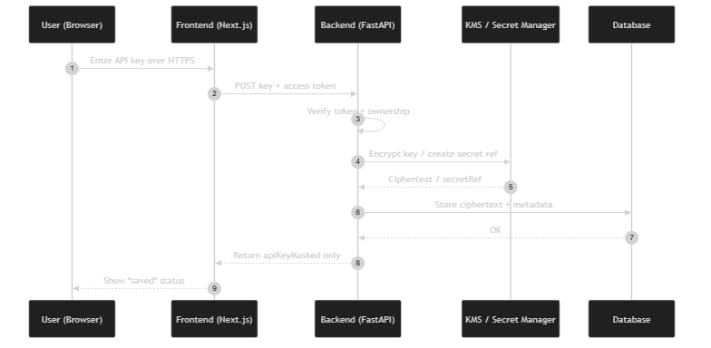
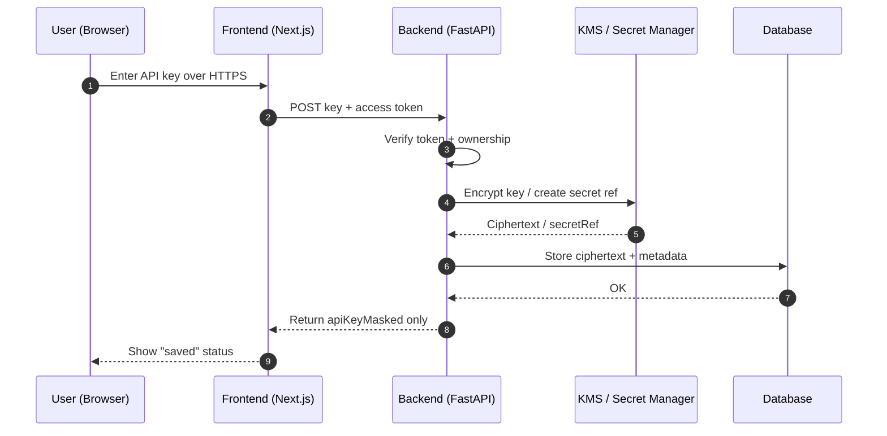
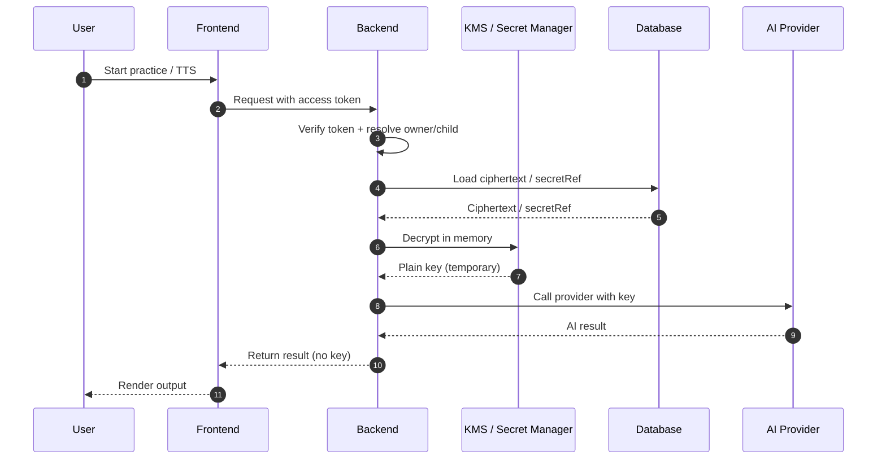

# API Key Flow (FE + BE)

## 1) Save API key flow

## 2) Runtime usage flow

## Security notes

- Do not store plaintext key in frontend.
- Do not return raw key to client.
- Redact key values in logs/monitoring.
- Rotate/revoke keys and apply rate limits.
