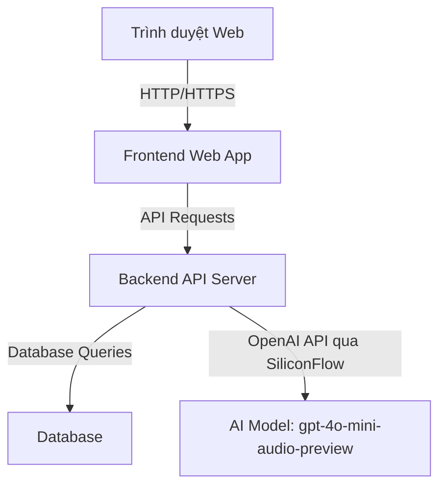
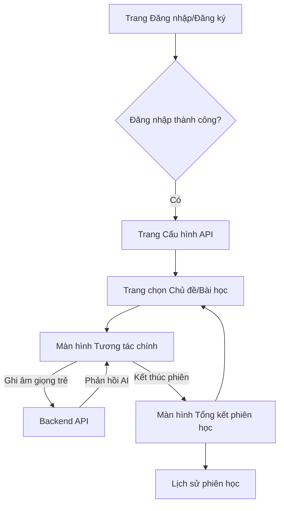

# Tài liệu thiết kế hệ thống: Trợ lý luyện nói tiếng Anh cho trẻ em người Việt

**Tác giả**: Manus AI
**Ngày**: 06 tháng 4 năm 2026

## 1. Giới thiệu

Tài liệu này trình bày phân tích và thiết kế hệ thống chi tiết cho một ứng dụng web đóng vai trò là trợ lý luyện nói tiếng Anh cho trẻ em người Việt. Ứng dụng sẽ tận dụng mô hình AI tiên tiến `gpt-4o-mini-audio-preview-2024-12-17` thông qua SiliconFlow API, cho phép cấu hình API key và base URL riêng cho từng người dùng. Mục tiêu chính là tạo ra một môi trường học tập tương tác, thân thiện, giúp trẻ em cải thiện kỹ năng phát âm và giao tiếp tiếng Anh.

## 2. Nghiên cứu và Yêu cầu hệ thống

### 2.1. Model gpt-4o-mini-audio-preview-2024-12-17

Model `gpt-4o-mini-audio-preview-2024-12-17` là một phiên bản xem trước của GPT-4o Audio mini, được thiết kế để xử lý cả đầu vào và đầu ra âm thanh. Đây là một mô hình đa phương thức (natively multimodal) có khả năng hiểu và tạo âm thanh trực tiếp. Việc sử dụng Chat Completions API với tham số `modalities: ["text", "audio"]` cho phép ứng dụng gửi cả văn bản và âm thanh làm đầu vào, và nhận phản hồi tương tự. Đối với đầu ra âm thanh, cần cấu hình các tùy chọn như `audio: {voice: "alloy", format: "wav"}` để chỉ định giọng nói và định dạng. Lợi ích chính của việc sử dụng mô hình này là độ trễ thấp hơn đáng kể so với việc xâu chuỗi các mô hình riêng lẻ như Speech-to-Text (Whisper), Language Model (LLM) và Text-to-Speech (TTS) [1].

### 2.2. SiliconFlow API Pattern

SiliconFlow cung cấp một giao diện API tương thích với OpenAI SDK, cho phép tích hợp dễ dàng. Base URL cho các yêu cầu API là `https://api.siliconflow.cn/v1` (hoặc `.com`). Xác thực được thực hiện thông qua Bearer Token, nơi `API Key` của người dùng được truyền trong header `Authorization: Bearer YOUR_API_KEY`. Một yêu cầu quan trọng của hệ thống là mỗi người dùng sẽ có khả năng lưu trữ và quản lý `api_key` và `base_url` riêng của họ trong hồ sơ hoặc cấu hình cá nhân [2].

### 2.3. Yêu cầu hệ thống cho trẻ em người Việt

Ứng dụng cần có giao diện thân thiện, trực quan, nhiều hình ảnh và nút bấm to, dễ tương tác để phù hợp với trẻ em. Các tính năng cốt lõi bao gồm:

*   **Ghi âm giọng nói của trẻ**: Cho phép trẻ dễ dàng ghi lại phát âm của mình.
*   **Phát âm thanh phản hồi từ AI**: AI sẽ phản hồi bằng giọng nói tự nhiên, khuyến khích và hướng dẫn trẻ.
*   **Hiển thị văn bản**: Hỗ trợ hiển thị văn bản (tiếng Anh và có thể kèm tiếng Việt) để trẻ học mặt chữ và hiểu nghĩa.
*   **Quản lý cấu hình API cá nhân**: Phụ huynh có thể dễ dàng cấu hình và quản lý API key của mình.
*   **Phản hồi phát âm**: Cung cấp đánh giá và gợi ý sửa lỗi phát âm cụ thể cho trẻ em người Việt.
*   **Hỗ trợ tiếng Việt**: Tích hợp các yếu tố hỗ trợ bằng tiếng Việt một cách tinh tế để giúp trẻ vượt qua rào cản ngôn ngữ khi cần.

## 3. Kiến trúc hệ thống tổng thể

Ứng dụng sẽ tuân theo kiến trúc phân lớp, có thể là Microservices hoặc Monolithic tùy thuộc vào quy mô ban đầu, với các thành phần chính như sau:

*   **Frontend (Client-side)**: Một ứng dụng web được xây dựng bằng các framework JavaScript hiện đại (ví dụ: React, Vue, Angular). Giao diện người dùng sẽ được thiết kế thân thiện, trực quan và dễ sử dụng cho trẻ em, tập trung vào các yếu tố hình ảnh và tương tác âm thanh. Frontend sẽ giao tiếp với Backend thông qua các API RESTful.

*   **Backend (Server-side)**: Một API server chịu trách nhiệm xử lý logic nghiệp vụ, quản lý người dùng, lưu trữ dữ liệu, và tương tác với mô hình AI. Backend có thể được phát triển bằng Node.js (Express/NestJS), Python (Django/FastAPI), hoặc Go (Gin/Echo). Các chức năng chính của Backend bao gồm:
    *   **Authentication & Authorization**: Quản lý đăng ký, đăng nhập và phân quyền người dùng.
    *   **User Management**: Quản lý thông tin cá nhân và cấu hình API của người dùng.
    *   **AI Integration**: Xử lý các yêu cầu gửi đến mô hình AI (gpt-4o-mini-audio-preview), bao gồm chuyển đổi giọng nói thành văn bản (STT) và chuyển đổi văn bản thành giọng nói (TTS), và nhận đánh giá phát âm.
    *   **Session Management**: Quản lý các phiên luyện nói của trẻ em.
    *   **Data Storage**: Tương tác với cơ sở dữ liệu để lưu trữ và truy xuất dữ liệu.

*   **Database**: Một hệ quản trị cơ sở dữ liệu quan hệ (ví dụ: PostgreSQL, MySQL) sẽ được sử dụng để lưu trữ dữ liệu có cấu trúc. Cơ sở dữ liệu sẽ chứa thông tin người dùng, cấu hình API, dữ liệu phiên học, và nhật ký tương tác.

*   **AI Model (External Service)**: Mô hình `gpt-4o-mini-audio-preview-2024-12-17` của OpenAI, được truy cập thông qua SiliconFlow API. Mô hình này sẽ chịu trách nhiệm chính trong việc hiểu giọng nói của trẻ, tạo phản hồi bằng giọng nói và cung cấp đánh giá phát âm.



## 4. Database Schema

Chúng ta sẽ thiết kế các bảng chính sau đây:

### 4.1. Bảng `users`

Lưu trữ thông tin cơ bản của người dùng (phụ huynh).

| Tên trường      | Kiểu dữ liệu       | Ràng buộc           | Mô tả                               |
| :-------------- | :----------------- | :------------------ | :---------------------------------- |
| `id`            | `UUID` hoặc `INT`  | `PRIMARY KEY`       | ID duy nhất của người dùng          |
| `username`      | `VARCHAR(255)`     | `UNIQUE`, `NOT NULL`| Tên đăng nhập                         |
| `email`         | `VARCHAR(255)`     | `UNIQUE`, `NOT NULL`| Email của người dùng                 |
| `password_hash` | `VARCHAR(255)`     | `NOT NULL`          | Hash của mật khẩu                     |
| `created_at`    | `TIMESTAMP`        | `DEFAULT CURRENT_TIMESTAMP`| Thời gian tạo tài khoản             |
| `updated_at`    | `TIMESTAMP`        | `DEFAULT CURRENT_TIMESTAMP ON UPDATE CURRENT_TIMESTAMP`| Thời gian cập nhật cuối cùng |

### 4.2. Bảng `user_api_configs`

Lưu trữ cấu hình API của từng người dùng cho SiliconFlow. `api_key` cần được mã hóa mạnh mẽ trước khi lưu trữ.

| Tên trường      | Kiểu dữ liệu       | Ràng buộc           | Mô tả                               |
| :-------------- | :----------------- | :------------------ | :---------------------------------- |
| `id`            | `UUID` hoặc `INT`  | `PRIMARY KEY`       | ID duy nhất của cấu hình API        |
| `user_id`       | `UUID` hoặc `INT`  | `FOREIGN KEY (users.id)`, `NOT NULL`| ID của người dùng sở hữu cấu hình |
| `api_key`       | `VARCHAR(255)`     | `NOT NULL`          | API Key của người dùng cho SiliconFlow (nên được mã hóa) |
| `base_url`      | `VARCHAR(255)`     | `NOT NULL`          | Base URL của SiliconFlow API (mặc định là `https://api.siliconflow.cn/v1`) |
| `model_name`    | `VARCHAR(255)`     | `DEFAULT 'gpt-4o-mini-audio-preview-2024-12-17'`| Tên model AI được sử dụng (có thể cấu hình) |
| `created_at`    | `TIMESTAMP`        | `DEFAULT CURRENT_TIMESTAMP`| Thời gian tạo cấu hình              |
| `updated_at`    | `TIMESTAMP`        | `DEFAULT CURRENT_TIMESTAMP ON UPDATE CURRENT_TIMESTAMP`| Thời gian cập nhật cuối cùng |

### 4.3. Bảng `learning_sessions`

Lưu trữ thông tin về các phiên luyện nói của trẻ em.

| Tên trường      | Kiểu dữ liệu       | Ràng buộc           | Mô tả                               |
| :-------------- | :----------------- | :------------------ | :---------------------------------- |
| `id`            | `UUID` hoặc `INT`  | `PRIMARY KEY`       | ID duy nhất của phiên học           |
| `user_id`       | `UUID` hoặc `INT`  | `FOREIGN KEY (users.id)`, `NOT NULL`| ID của người dùng (phụ huynh)       |
| `child_name`    | `VARCHAR(255)`     | `NULLABLE`          | Tên của trẻ (nếu có)                |
| `start_time`    | `TIMESTAMP`        | `NOT NULL`          | Thời gian bắt đầu phiên học         |
| `end_time`      | `TIMESTAMP`        | `NULLABLE`          | Thời gian kết thúc phiên học        |
| `topic`         | `VARCHAR(255)`     | `NULLABLE`          | Chủ đề của phiên học (ví dụ: Animals, Colors) |
| `score`         | `INT`              | `NULLABLE`          | Điểm số hoặc đánh giá phiên học     |

### 4.4. Bảng `interaction_logs`

Lưu trữ nhật ký các tương tác giữa trẻ em và AI trong mỗi phiên luyện nói.

| Tên trường      | Kiểu dữ liệu       | Ràng buộc           | Mô tả                               |
| :-------------- | :----------------- | :------------------ | :---------------------------------- |
| `id`            | `UUID` hoặc `INT`  | `PRIMARY KEY`       | ID duy nhất của log tương tác       |
| `session_id`    | `UUID` hoặc `INT`  | `FOREIGN KEY (learning_sessions.id)`, `NOT NULL`| ID của phiên học                    |
| `timestamp`     | `TIMESTAMP`        | `DEFAULT CURRENT_TIMESTAMP`| Thời gian tương tác                 |
| `user_audio_url`| `VARCHAR(255)`     | `NULLABLE`          | URL của file ghi âm giọng nói của trẻ |
| `user_text_input`| `TEXT`             | `NULLABLE`          | Văn bản được phiên âm từ giọng nói của trẻ |
| `ai_audio_url`  | `VARCHAR(255)`     | `NULLABLE`          | URL của file âm thanh phản hồi từ AI |
| `ai_text_output`| `TEXT`             | `NULLABLE`          | Văn bản phản hồi từ AI              |
| `pronunciation_score`| `INT`              | `NULLABLE`          | Điểm phát âm (0-100)                |
| `feedback_text` | `TEXT`             | `NULLABLE`          | Phản hồi bằng văn bản từ AI         |
| `suggested_correction`| `TEXT`             | `NULLABLE`          | Gợi ý sửa lỗi phát âm (nếu có)      |

### 4.5. Bảng `topics`

Lưu trữ danh sách các chủ đề luyện nói có sẵn.

| Tên trường      | Kiểu dữ liệu       | Ràng buộc           | Mô tả                               |
| :-------------- | :----------------- | :------------------ | :---------------------------------- |
| `id`            | `UUID` hoặc `INT`  | `PRIMARY KEY`       | ID duy nhất của chủ đề              |
| `name`          | `VARCHAR(255)`     | `UNIQUE`, `NOT NULL`| Tên chủ đề (tiếng Anh)              |
| `description`   | `TEXT`             | `NULLABLE`          | Mô tả chủ đề                        |
| `image_url`     | `VARCHAR(255)`     | `NULLABLE`          | URL hình ảnh đại diện cho chủ đề    |

## 5. Thiết kế chi tiết Backend API và Business Logic

### 5.1. Các API Endpoints

Các API endpoints sẽ được thiết kế theo chuẩn RESTful, sử dụng JSON làm định dạng dữ liệu chính, tập trung vào các chức năng hỗ trợ luyện nói tiếng Anh cho trẻ em.

| Endpoint                               | HTTP Method | Mô tả                                                                 |
| :------------------------------------- | :---------- | :-------------------------------------------------------------------- |
| `/api/auth/register`                   | `POST`      | Đăng ký tài khoản người dùng mới (phụ huynh).                         |
| `/api/auth/login`                      | `POST`      | Đăng nhập người dùng và trả về JWT/Session Token.                     |
| `/api/users/me`                        | `GET`       | Lấy thông tin người dùng hiện tại.                                    |
| `/api/user-configs/api-keys`           | `GET`       | Lấy cấu hình API key của người dùng.                                  |
| `/api/user-configs/api-keys`           | `POST`      | Tạo hoặc cập nhật cấu hình API key và base URL cho người dùng.       |
| `/api/user-configs/api-keys`           | `DELETE`    | Xóa cấu hình API key của người dùng.                                  |
| `/api/learning-sessions`               | `POST`      | Bắt đầu một phiên luyện nói mới.                                      |
| `/api/learning-sessions/{session_id}`  | `GET`       | Lấy thông tin chi tiết của một phiên luyện nói.                       |
| `/api/learning-sessions/{session_id}/end`| `POST`      | Kết thúc một phiên luyện nói.                                         |
| `/api/learning-sessions/{session_id}/interact`| `POST`      | Gửi audio của trẻ đến AI, nhận phản hồi audio và đánh giá.            |
| `/api/learning-sessions/{session_id}/interactions`| `GET`       | Lấy lịch sử tương tác trong một phiên luyện nói.                      |
| `/api/topics`                          | `GET`       | Lấy danh sách các chủ đề luyện nói có sẵn.                           |

### 5.2. Định dạng Request/Response chi tiết

*   **Đăng ký người dùng (`POST /api/auth/register`)**:
    *   **Request Body**: `{"username": "string", "email": "string", "password": "string"}`
    *   **Response (Success 201 Created)**: `{"message": "User registered successfully", "user_id": "uuid"}`

*   **Đăng nhập người dùng (`POST /api/auth/login`)**:
    *   **Request Body**: `{"username": "string", "password": "string"}`
    *   **Response (Success 200 OK)**: `{"message": "Login successful", "access_token": "string", "token_type": "bearer"}`

*   **Cấu hình API Key (`POST /api/user-configs/api-keys`)**:
    *   **Request Body**: `{"api_key": "string", "base_url": "string", "model_name": "string" (optional, default: gpt-4o-mini-audio-preview-2024-12-17)}`
    *   **Response (Success 200 OK)**: `{"message": "API configuration updated successfully"}`

*   **Tương tác trong phiên luyện nói (`POST /api/learning-sessions/{session_id}/interact`)**:
    *   **Request Body** (multipart/form-data, chứa file audio):
        ```
        --boundary
        Content-Disposition: form-data; name="audio_file"; filename="user_audio.wav"
        Content-Type: audio/wav

        <binary audio data>
        --boundary--
        ```
    *   **Response (Success 200 OK)**:
        ```json
        {
            "user_text_input": "string",
            "ai_audio_url": "string",
            "ai_text_output": "string",
            "evaluation": {
                "pronunciation_score": "integer (0-100)",
                "feedback_text": "string (e.g., 'Great pronunciation!', 'Try to say 'apple' more clearly.')",
                "suggested_correction": "string (optional, e.g., 'The correct pronunciation of 'apple' is...')"
            }
        }
        ```

*   **Lấy danh sách chủ đề luyện nói (`GET /api/topics`)**:
    *   **Response (Success 200 OK)**:
        ```json
        [
            {
                "id": "uuid",
                "name": "Animals",
                "description": "Learn about different animals",
                "image_url": "string (URL to topic icon/image)"
            },
            {
                "id": "uuid",
                "name": "Food",
                "description": "Talk about your favorite foods",
                "image_url": "string"
            }
        ]
        ```

### 5.3. Business Logic Flow

1.  **Quản lý người dùng và xác thực**: Người dùng (phụ huynh) đăng ký, đăng nhập và nhận JWT/Session Token. `api_key` của người dùng được mã hóa và lưu trữ an toàn trong DB.
2.  **Quản lý cấu hình AI**: Phụ huynh có thể cập nhật `api_key`, `base_url`, và `model_name`. Backend sẽ giải mã `api_key` khi gọi SiliconFlow API.
3.  **Xử lý phiên luyện nói và tương tác AI**:
    *   **Bắt đầu phiên**: Tạo bản ghi `learning_sessions` khi chọn chủ đề.
    *   **Tương tác AI**: Frontend gửi audio của trẻ. Backend xử lý audio, gọi SiliconFlow API (STT, LLM với `system_prompt` hướng dẫn vai trò trợ lý, TTS), nhận phản hồi (văn bản, audio, đánh giá phát âm chi tiết), lưu vào `interaction_logs`, và trả về cho Frontend.
    *   **Kết thúc phiên**: Cập nhật `end_time` và `score` trong `learning_sessions`.
4.  **Quản lý chủ đề luyện nói**: Backend cung cấp danh sách các chủ đề được định nghĩa trước.

### 5.4. Xử lý lỗi

Backend sẽ trả về các mã trạng thái HTTP thích hợp và thông báo lỗi rõ ràng cho Frontend, bao gồm `400 Bad Request`, `401 Unauthorized`, `403 Forbidden`, `404 Not Found`, `500 Internal Server Error`, và `502 Bad Gateway`.

## 6. Thiết kế Frontend Architecture và UI/UX Flow

### 6.1. Kiến trúc Frontend

Frontend sẽ là một SPA sử dụng React.js với cấu trúc component-based, quản lý trạng thái bằng Redux/Zustand/Context API, sử dụng React Router cho routing, Axios/Fetch API để giao tiếp với Backend, và Web Audio API/thư viện chuyên dụng để ghi âm/phát audio. Hỗ trợ i18n (tiếng Việt) sẽ được tích hợp.

### 6.2. UI/UX Flow cho trợ lý nói tiếng Anh

1.  **Luồng đăng nhập/Đăng ký & Cấu hình**: Giao diện đơn giản cho phụ huynh, hỗ trợ đăng nhập qua mạng xã hội. Trang cấu hình API với hướng dẫn tiếng Việt và nút kiểm tra kết nối.
2.  **Luồng luyện nói chính (Core Speaking Practice Flow)**:
    *   **Trang chọn chủ đề/Bài học**: Hình ảnh minh họa sinh động, tên chủ đề tiếng Anh (kèm tiếng Việt nhỏ).
    *   **Màn hình tương tác chính (Chat/Practice Screen)**:
        *   **Nhân vật AI (Avatar)**: Hoạt hình thân thiện, biểu cảm, hoạt ảnh khi nói/nghe.
        *   **Vùng hiển thị hội thoại**: Bong bóng thoại lớn, font chữ thân thiện, phân biệt màu sắc giữa AI và trẻ.
        *   **Nút ghi âm (Record Button)**: To, nổi bật, biểu tượng micro rõ ràng, hiệu ứng hình ảnh/âm thanh khi ghi âm.
        *   **Nút phát lại (Play Button)**: Bên cạnh mỗi bong bóng thoại.
        *   **Hiển thị phản hồi (Feedback Display)**: Điểm số/biểu tượng cảm xúc, văn bản khuyến khích/gợi ý sửa lỗi (có thể bằng tiếng Việt), gợi ý sửa lỗi cụ thể (audio).
        *   **Hỗ trợ tiếng Việt**: Nút "Trợ giúp"/"Giải thích" (biểu tượng bóng đèn/dấu hỏi) để giải thích bằng tiếng Việt.
        *   **Thanh tiến độ/Điểm số**: Trực quan để theo dõi tiến bộ.



### 6.3. Các yếu tố UI/UX quan trọng cho trẻ em người Việt

*   **Màu sắc tươi sáng, hình ảnh động**: Bảng màu vui tươi, hình ảnh minh họa và hoạt ảnh sinh động, nhân vật hoạt hình thân thiện.
*   **Font chữ lớn, dễ đọc**: Đảm bảo văn bản rõ ràng, dễ đọc.
*   **Nút bấm to, dễ chạm**: Các nút tương tác chính có kích thước lớn.
*   **Phản hồi tức thì và tích cực**: Phản hồi âm thanh và hình ảnh ngay lập tức, tập trung khuyến khích.
*   **Gamification**: Tích hợp điểm số, huy hiệu, phần thưởng ảo để khuyến khích.
*   **Hỗ trợ ngôn ngữ mẹ đẻ (tiếng Việt)**: Tùy chọn hỗ trợ tiếng Việt tinh tế.
*   **An toàn và riêng tư**: Đảm bảo ứng dụng an toàn, không quảng cáo, bảo vệ dữ liệu cá nhân.

## 7. Kết luận

Thiết kế hệ thống này cung cấp một lộ trình toàn diện để phát triển một ứng dụng web trợ lý luyện nói tiếng Anh hiệu quả cho trẻ em người Việt. Bằng cách kết hợp công nghệ AI tiên tiến, kiến trúc hệ thống mạnh mẽ và thiết kế UI/UX thân thiện với trẻ em, ứng dụng sẽ tạo ra một trải nghiệm học tập hấp dẫn và hiệu quả, giúp trẻ tự tin hơn trong giao tiếp tiếng Anh.

## 8. Tài liệu tham khảo

[1] OpenAI API Documentation. *Audio and speech*. Available at: [https://developers.openai.com/api/docs/guides/audio](https://developers.openai.com/api/docs/guides/audio)
[2] SiliconFlow Documentation. *Quickstart*. Available at: [https://docs.siliconflow.cn/en/userguide/quickstart](https://docs.siliconflow.cn/en/userguide/quickstart)
uvicorn be.app.main:app --reload --host 0.0.0.0 --port 8000